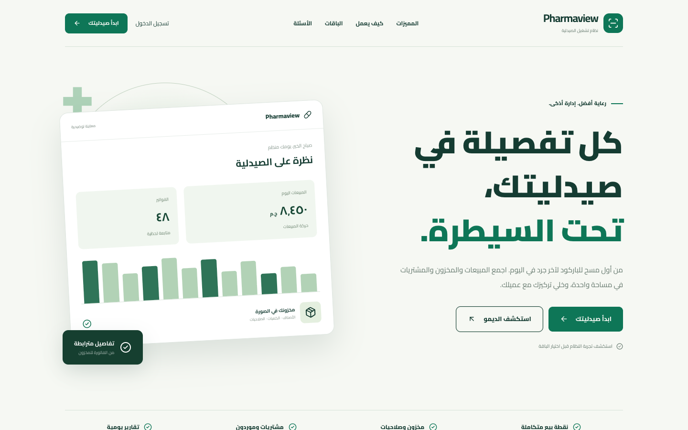
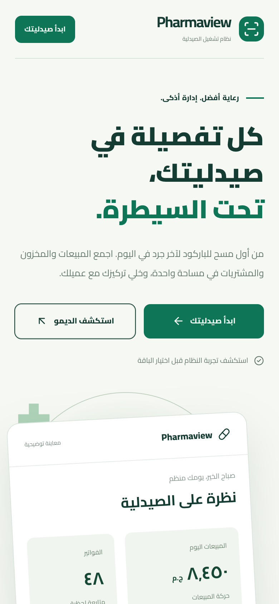
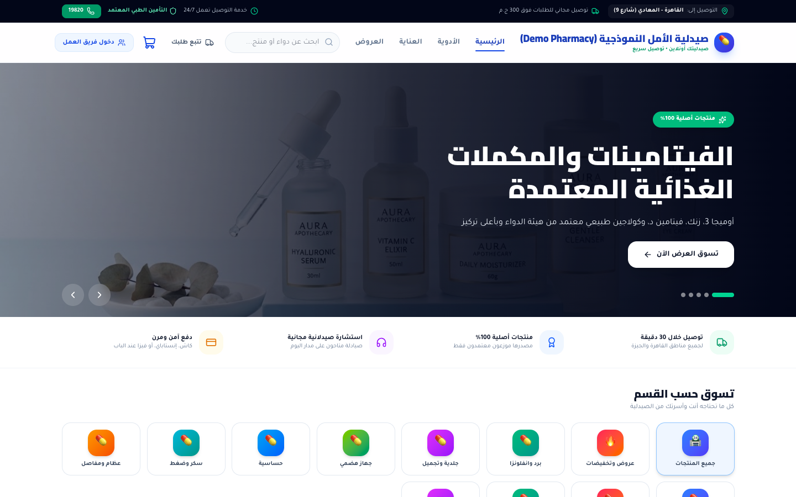
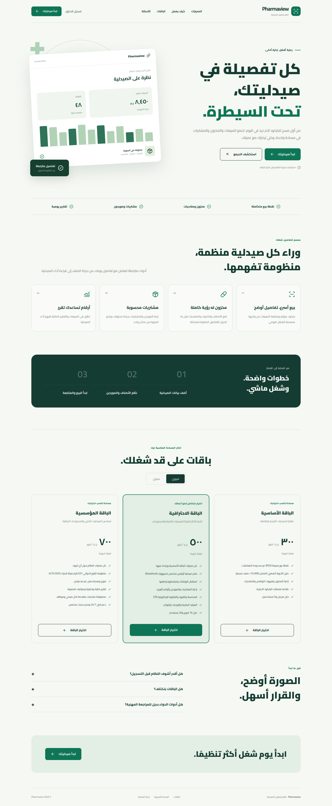

# Pharmaview

> Pharmacy management platform for Egypt.

**Live:** [pharmacy.virvib.com](https://pharmacy.virvib.com/) · **Role:** Founder & developer · **Period:** 2026 · **For:** Own product

   

## Overview

Pharmacies run their POS, stock and online orders from one system.

## What it does

- POS that screens the basket for drug interactions before dispensing
- Prescriptions and online orders end to end, with order tracking
- Stocktaking, returns and staff management
- Egyptian Drug Authority catalog sync
- Thermal receipt printing
- Subscription plans managed from the dashboard

## Engineering highlights

- Database per pharmacy
- Background jobs for catalog synchronization

## Screenshots (live site)

  
  

Full home page

---

Source code is private (client / commercial project). This repository documents the work only.

Built by **Ahmed Gamal** — Senior Laravel Developer · [LinkedIn](https://www.linkedin.com/in/wzcoder/) · [GitHub](https://github.com/ahmed-gamal-dev)
